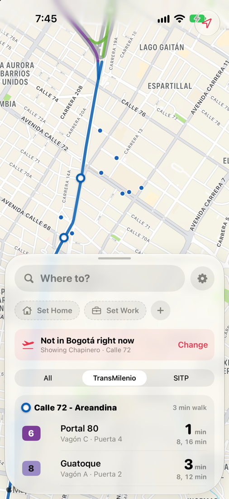
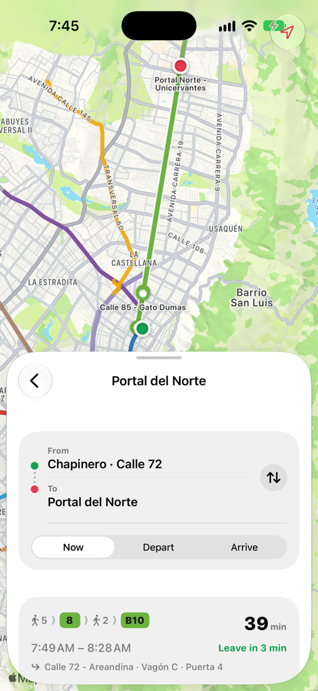
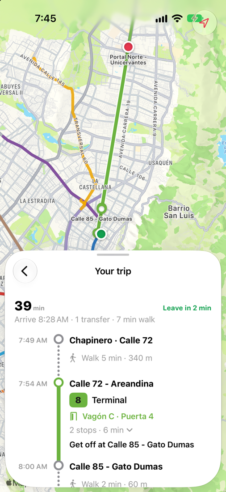

# Rolo

A Transit-style iPhone app for Bogotá: TransMilenio trunk and SITP buses, nearby departures, trip
planning, and which vagón and puerta to board from. It runs against its own router, built nightly
from TransMilenio's official schedule.

<p>
  
  
  
</p>

## Why it exists

Every open-data trip planner I tried routed Bogotá on zonal buses only. The TransMilenio trunk
lines, the backbone of the system, weren't there.

The reason: TransMilenio's public GTFS feed had **no trunk (Troncal) routes at all** until the
2026-03-17 export. Aggregators still read an old copy. Transitous, for example, gets Bogotá through
the transit.land atlas, which is pinned to the 2024-02-21 export. So the data exists now, but
nobody downstream picked it up.

Rolo skips the middlemen: it pulls TransMilenio's current daily export, fixes its known defects,
and runs [MOTIS](https://github.com/motis-project/motis) on it. You get all ~113 trunk services
with real stop times, plus the wagon and door you board from, which TransMilenio encodes in its
platform names. The research behind this is in [docs/DATA_SOURCES.md](docs/DATA_SOURCES.md).

## What's in here

| Path | What |
|---|---|
| `ios/` | SwiftUI app (iOS 26+). `project.yml` is the source of truth for [XcodeGen](https://github.com/yonaskolb/XcodeGen). |
| `server/` | MOTIS 2 router: `setup.sh` once, `serve.sh` to run, `refresh.sh` for a newer feed. The binary and data are downloaded, never committed. |
| `tools/prepare_gtfs.py` | Cleans the official export: zone colors for trunk routes, SITP colors for zonal, headsigns, drops trips with no stop_times, rejects partial exports. |
| `tools/fetch_latest_gtfs.py` | Finds the newest *usable* daily export (some are defective) and builds it atomically. |
| `tools/build_app_data.py` | Bundles trunk stations and corridor lines into the app (`ios/Rolo/Resources/network.json`). |
| `tools/make_icon.swift` | Renders the app icon. |

## Run it

You need macOS with Xcode 26, Python 3, and [XcodeGen](https://github.com/yonaskolb/XcodeGen)
(`brew install xcodegen`).

**1. Start the router**

```bash
server/setup.sh
```

```bash
server/serve.sh
```

`setup.sh` downloads the MOTIS binary, a Bogotá OpenStreetMap extract (via BBBike), and the newest
valid TransMilenio export (~120 MB), then imports them. It works on macOS (Apple silicon) and Linux
(x86-64 or arm64). `serve.sh` runs the router on `http://localhost:8080`.

To pick up a newer schedule later, stop the router and run `server/refresh.sh`.

**2. Run the app**

```bash
cd ios && xcodegen generate && open Rolo.xcodeproj
```

Pick an iPhone simulator and Run. The app talks to `http://localhost:8080` by default.

If you're not in Bogotá, the app says so and pretends you're at a spot in the city (Settings →
"Pretend I'm at"). At night there's nothing to show, so Debug builds can time-travel: add the
launch argument `-roloTimeTravel 2026-11-17T12:45:00Z` (7:45 AM Bogotá) to the scheme.

### On a real iPhone

Copy `ios/Config/Local.xcconfig.example` to `ios/Config/Local.xcconfig` (git-ignored), set your
own bundle prefix and Apple team ID, and run `xcodegen generate` again.

The phone has to reach a router. In the app's Settings, either point it at your Mac
(`http://<Mac's IP>:8080`, same Wi-Fi, while `serve.sh` runs) or host the router somewhere. It
uses about 100 MB of RAM, so any small VPS is enough.

## Known gaps

- Scheduled times only. TransMilenio doesn't publish a public real-time feed.
- Stations closed for Metro construction drop out when TransMilenio updates its feed, not before.
- Zone colors approximate the official map palette (`ZONE_COLORS` in `tools/prepare_gtfs.py`).
- Loop SITP routes show both ends ("Centro Andino ⇄ Calandaima"); direction is clear in the line view.
- The Transitous option in Settings works, but its Bogotá data has no trunk routes (see above).

## Data and attribution

- **Schedules:** TRANSMILENIO S.A. open GTFS feed, [CC BY-SA 4.0](https://creativecommons.org/licenses/by-sa/4.0/)
  (datos.gov.co `nysb-4689`). Downloaded by the scripts at setup time; not redistributed here.
- **Stations and corridors:** TRANSMILENIO S.A. ArcGIS layers
  ("Fuente: TRANSMILENIO S.A: www.transmilenio.gov.co"). A small extract joined with GTFS station
  ids lives in `server/data/ref/` and is bundled into the app as `network.json`; those files are
  shared under CC BY-SA 4.0. See [server/data/ref/NOTICE.md](server/data/ref/NOTICE.md).
- **Streets and geocoding:** © OpenStreetMap contributors, [ODbL](https://opendatacommons.org/licenses/odbl/).
  Downloaded at setup time; not redistributed here.
- **Routing:** [MOTIS](https://github.com/motis-project/motis) (MIT), downloaded as a release binary.

This is a personal project. It isn't affiliated with or endorsed by TRANSMILENIO S.A.

## License

Code: [MIT](LICENSE). The bundled transit data files keep their own license (CC BY-SA 4.0), as
described above.
